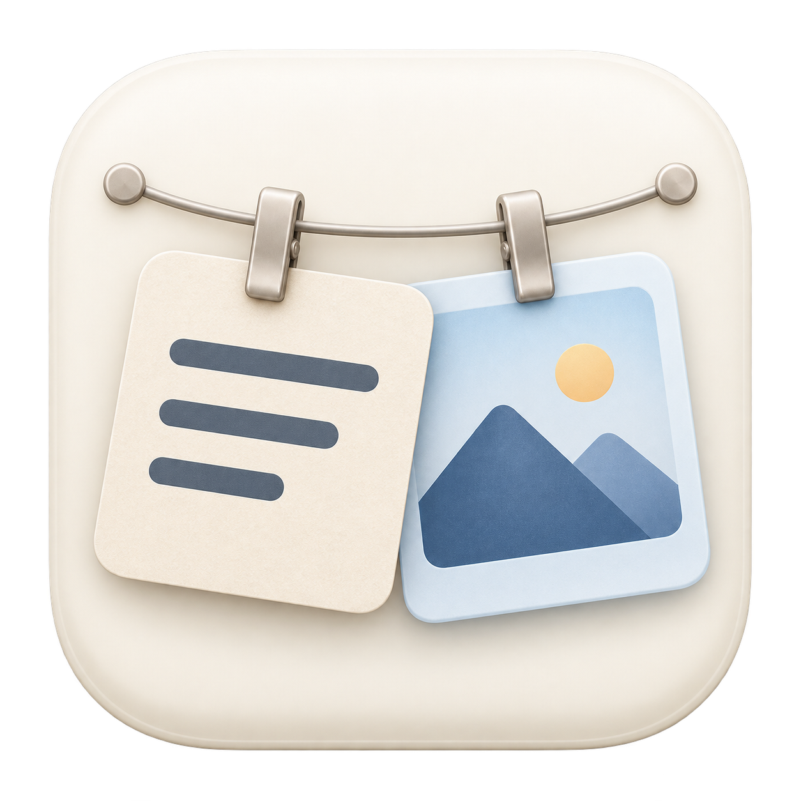

# Clipline



**让文字与图片一起，挂在 Mac 屏幕顶部。**

[English](README.md) · [更新记录](CHANGELOG.md) · [参与贡献](CONTRIBUTING.md) · [许可证](LICENSE)

Clipline 是基于开源项目 [Tendedero](https://github.com/alejandrobujan/tendedero) 的独立衍生版本，基线为 [`71b54fd`](https://github.com/alejandrobujan/tendedero/commit/71b54fd8c571c5ea8c514b56103dfa6bf08a8e74)。**核心补充是文字内容的挂起：在原有截图晾绳基础上增加文字剪贴板，让文字与图片两种模式可以独立开启、同时使用。**

晾绳、夹子和悬浮卡片交互源于 Tendedero。Clipline 在此基础上增加文字捕获、全文阅读、搜索与本地历史，并使用独立名称和生成图标；本项目与原作者没有隶属关系，也不代表原作者背书。

## 项目亮点与改进

- **文字、图片双模式**：文字复制监听与图片复制监听可分别开启；截图接管另有独立开关。
- **左右分组，一眼定位**：左侧文字、右侧图片，各自最新一条靠近中央，越向外越旧。
- **文字卡片更实用**：“文字”标题增大，正文连续展示多段内容，尽量填满缩略图；超出部分在鼠标悬停的全文预览中阅读。
- **从查看到复用**：悬停阅读与滚动全文，点击复制，支持搜索缩略图之外的正文；保留原始空格、换行和 Unicode。
- **轻量视觉区分**：文字采用浅燕麦色，图片采用雾蓝色；夹子和阴影更淡，外框尺寸统一。图片等比例适配，不修改原图。
- **两侧独立滚动**：统一滚动输入规则；浏览结束并离开后，缓慢回到最新内容。阅读弹窗期间保持位置。
- **本地历史与去重**：重复复制已有文字会移至最新；点击卡片复制不会增加重复条目；退出重启后恢复历史。

```text
旧文字 ← 6 5 4 3 2 1  |  1 2 3 4 5 6 → 旧图片
                     最新
```

## 系统运行环境

| 项目 | 要求 |
| --- | --- |
| 操作系统 | macOS 14 Sonoma 或更高版本；不支持 Windows 和 Linux |
| 芯片 | Apple Silicon 或 Intel，构建通用双架构应用 |
| 源码编译 | Apple Swift 5.9+ 和 macOS 14+ SDK，由兼容的 Xcode 或 Command Line Tools 提供 |
| 额外运行环境 | 不需要安装 Python、Node.js 或 Homebrew |
| 发布形式 | 源码 ZIP 和本地签名的通用 DMG；未经过 Apple 公证 |
| 已验证 | GitHub macOS 14 环境通过 15 项测试和双架构编译；本地 Apple Silicon 编译、安装通过 |

Intel 已通过编译，但尚未完成 Intel 实机运行验证；更广泛的 UI 验收仍待完善。

## 使用 DMG 安装

1. 从 [发布页面](https://github.com/soroyue/Clipline/releases/latest) 下载 `Clipline-0.2.0.dmg`。
2. 更新前先退出正在运行的 Clipline。打开 DMG，将 Clipline 拖到 Applications 文件夹。
3. 弹出磁盘镜像，再从 Applications 打开应用，在菜单中开启所需记录功能。

运行 DMG 中的应用不需要开发工具。它使用 ad hoc 本地签名，没有 Developer ID 签名或 Apple 公证，首次启动可能被 macOS 阻止；不要关闭系统安全保护。如果你的安全策略不允许此类安装，请使用源码编译方式。源码安装脚本使用 `~/Applications`，已有用户请保留一个安装位置，避免出现两个副本。

自行制作 DMG：执行 `bash scripts/make-dmg.sh`。镜像包含应用、Applications 快捷方式、LICENSE 和 NOTICE。

## 编译与安装

### 首次准备开发工具

如果尚未安装，在“终端”执行：

```bash
xcode-select --install
```

按系统提示完成安装后再继续；已经安装则跳过。检查工具是否可用：

```bash
xcrun swift --version
xcrun --sdk macosx --show-sdk-path
```

### 方式一：下载源码 ZIP（无需使用 Git）

1. 打开 [最新发布页](https://github.com/soroyue/Clipline/releases/latest)，下载名为 `Clipline-…-source.zip` 的附件。
2. 在 Finder 中解压。源码包不是应用，需要执行下一步编译。
3. 打开“终端”，输入 `cd `（注意后面的空格），将解压后的 `Clipline` 文件夹拖进终端，按回车。
4. 执行：

```bash
bash Install-and-Test-on-Mac.command
```

不需要使用 `sudo`。保持终端打开，直到看到 `Installed:`；耗时取决于电脑性能。

### 方式二：使用 Git 下载


需要 macOS 14 或更高版本，以及 Apple Swift 工具链（Xcode 或 Command Line Tools）。构建产物包含 Apple Silicon 和 Intel 架构。提供源码和本地签名的 DMG，DMG 尚未经过 Apple 公证。

```bash
git clone https://github.com/soroyue/Clipline.git
cd Clipline
bash Install-and-Test-on-Mac.command
```

脚本会执行测试和翻译检查，构建并验证应用，备份已有 Clipline，然后安装到 `~/Applications/Clipline.app` 并打开。没有 Developer ID 时使用本地 ad hoc 签名，不修改系统安全设置。

安装脚本会自动适配工具链的两个缺口：macOS 27 的 Command Line Tools 所用 SDK，其 SwiftUI 需要这些工具未附带的宏插件，因此脚本会改用已安装的最新版 macOS 26 SDK 编译；这些工具也不包含 XCTest，脚本会给出提示并跳过自动化测试，CI 仍会在每次推送时运行它们。如需在本地运行测试，请安装完整版 Xcode，或用 `DEVELOPER_DIR` 指向它：

```bash
DEVELOPER_DIR=/Applications/Xcode.app/Contents/Developer bash Install-and-Test-on-Mac.command
```

仅测试和构建：

```bash
swift test
swift scripts/check-strings.swift
bash scripts/build-app.sh release
```

## 常见问题、升级与卸载

- **打开后没有窗口**：这是菜单栏应用。在 Finder 中打开 `~/Applications/Clipline.app`，然后查看顶部菜单栏图标。
- **复制文字没有卡片**：先开启“悬挂复制的文字”，再复制新的非空文字；开启前的内容不会导入。
- **缺少 Swift 或 SDK**：先完成 Command Line Tools 安装，再运行上面的检查命令。较新的 SDK 可能需要匹配的新工具链。
- **安装时提示跳过测试**：当前工具链不含 XCTest，单独安装 Command Line Tools 时就是这种情况。编译和安装仍会继续，CI 每次推送都会运行测试。如需本地运行，请安装完整版 Xcode 或按上文设置 `DEVELOPER_DIR`。
- **出现 `SwiftUIMacros.StateMacro could not be found`**：默认 SDK 的 SwiftUI 需要当前工具链没有的宏插件。安装脚本会自动改用最新版 macOS 26 SDK；在脚本之外手动执行 `swift test` 时，可能仍需把 `SDKROOT` 指向 macOS 26 SDK。
- **请求文件夹权限**：仅允许访问你希望监听的截图文件夹，或另选一个文件夹。
- **系统阻止下载的应用**：本项目尚未公证，建议自行编译公开源码；不要全局关闭 Gatekeeper。
- **测试或编译失败**：安装会停止，日志在 `build/logs/`。提交 issue 前请遮挡个人路径，只提供必要的报错片段。
- **升级**：下载新版源码后重新执行安装脚本；使用 Git 的用户可在无本地改动的仓库执行 `git pull --ff-only` 后重新安装。旧应用备份在 `build/backups/`，本地历史会保留。
- **卸载**：先关闭“登录时启动”，退出 Clipline，再将 `~/Applications/Clipline.app` 移至废纸篓。这不会删除历史；只有确定不再需要时才单独清除历史数据。

## 三种显示模式

在菜单“显示模式”中选择**纯图片、纯文字、文字＋图片（左右分组）**。单类型模式采用原版居中晾绳与滚动布局，不使用分组归中动画；双类型模式采用左文字、右图片布局。切换不删除任何历史；记录开关仍独立，可以分别决定“记录什么”和“展示什么”。

## 0.2.0 新增功能

- **浏览历史…**：按“全部／文字／图片”分组，搜索文字全文或图片文件名，复制记录、打开原图或移除单条卡片。图片搜索不包含 OCR 文字识别。
- **暂停记录／恢复记录**：暂停添加剪贴板和截图卡片，保留已有历史；菜单栏显示暂停图标，状态在重启后仍保留。系统截图仍会保存到已配置目录，暂停并不阻止系统截图。恢复时跳过当前剪贴板，只记录之后的新复制。
- **交互设置…**：可调整顶部展开等待、普通离开后的总收起时间（含动画）、归中动画和新内容展示时间；修改即时保存。“恢复默认设置”分别恢复为 0.5／1.2／1.4／2.5 秒。浏览后先等待 0.7 秒，归中动画完成后才收起。

## 使用方法

1. 打开 Clipline，在顶部菜单栏找到应用图标；它没有普通主窗口。
2. 开启“悬挂复制的文字”或图片复制监听，也可以同时开启；按需单独开启截图接管。
3. 复制新内容。开启监听前的剪贴板内容不会自动导入。
4. 鼠标在菜单栏停留约 0.5 秒展开晾绳；左侧查看文字，右侧查看图片。
5. 悬停文字卡片阅读全文，点击复制，或使用“浏览历史…”检索。

普通离开后等待约 0.98 秒，再经过 0.22 秒动画收起，总计约 1.2 秒。滚动历史后离开，会先等待约 0.7 秒，再用 1.4 秒缓慢归中，约 2.5 秒后开始收起。阅读预览或操作卡片时保持展开。新内容自动展示另有 2.5 秒停留时间。上述时间均为近似值。

文字和图片共用历史容量，可选择 25、50、100 条或仅保留适合屏幕的数量。文字删除和容量淘汰会直接删除对应本地文件；图片删除行为取决于其是否属于应用管理的文件。

## 隐私说明

历史保存在本机，**没有加密**。文字位于 `~/Library/Application Support/Clipline/Text`，创建时设置为仅当前用户可访问。启用监听时请注意敏感内容。

程序跳过空白文字、文件复制、超过 1 MiB 的文字，以及带有已识别私密、临时、自动生成标记的内容。标记依赖来源应用，不能保证识别所有敏感信息。应用没有实现云同步或剪贴板上传；应用内不提供检查更新功能；新版请从 GitHub Releases 手动下载。

公开源码包不包含剪贴板历史、个人截图、本机日志、构建缓存、备份或开发会话文件。涉及安全问题请先阅读 [SECURITY.md](SECURITY.md)。

## 验证状态与限制

15 项自动化测试覆盖原文保真、持久化及权限、去重、复制、删除、容量淘汰、过滤、图片捕获和分组滚动。本机 macOS 测试及双架构编译已通过；仓库配置了 GitHub Actions 自动检查。

视觉效果、多显示器、全屏及手势体验仍需要更广泛的人工验证；测试通过不等于全部 UI 验收通过。Intel 已通过目标架构构建，但未在 Intel 实机验证运行。

## 开源与致谢

采用 [MIT 许可证](LICENSE)，完整保留原作者 **Copyright (c) 2026 Alejandro Buján** 及授权声明。原项目名称与图标不属于 MIT 授权范围。Clipline 使用独立应用名称和生成图标；内部 Swift 模块仍保留 `Tendedero` 名称以保持兼容。来源和改动范围见 [NOTICE](NOTICE)。
